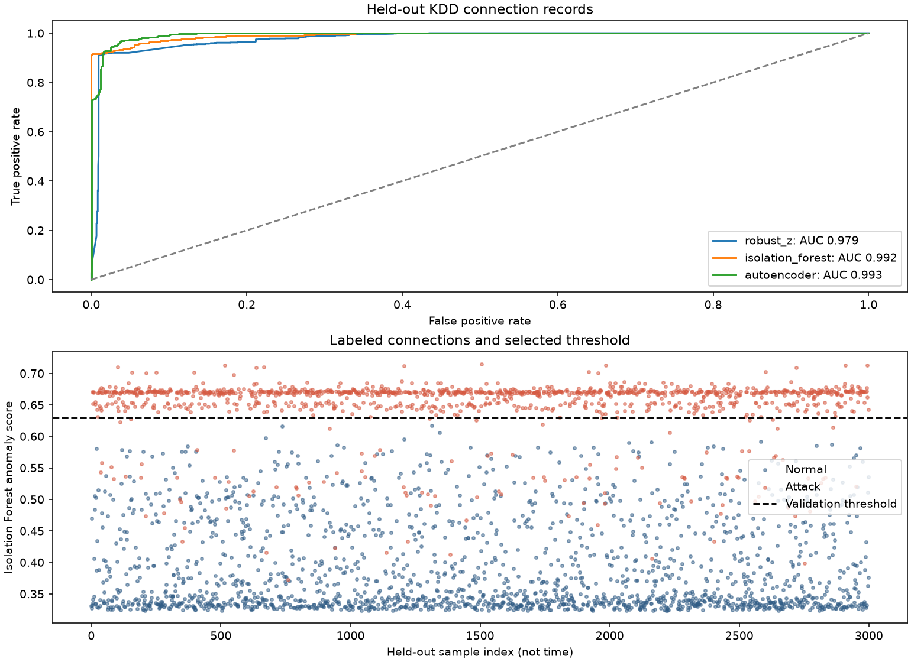

# Network intrusion anomaly experiment

This run uses KDD Cup 1999 connection records from the checksum-verified scikit-learn mirror. Training, validation, and test records are feature-disjoint after removing duplicates and ambiguous labels. The split is random and stratified, not chronological or the official KDD test partition.

| Detector | Precision | Recall | F1 | ROC-AUC |
|---|---:|---:|---:|---:|
| Robust Z | 0.9801 | 0.9101 | 0.9438 | 0.9785 |
| Isolation Forest | 1.0000 | 0.9067 | 0.9511 | 0.9916 |
| PyTorch autoencoder | 0.9536 | 0.9496 | 0.9516 | 0.9934 |

The test has 3,000 connections. The 6,000-row training partition contains 3,620 normal records used for fitting. The 2,000-row validation partition selects settings and thresholds. These are semi-supervised anomaly detectors, with labels used to select normal training rows and tune validation thresholds.

`metrics.json` contains the exact results and selected settings. `validation.json` records candidate settings and validation scores. `predictions.csv` contains held-out labels, scores, and predictions. `split-records.csv` identifies all sampled records and splits. `experiment.json` records the archive checksum, cleaning counts, environment, and limitations.

These are simulated intrusions from a 1999 benchmark. The scores do not establish modern production detection rates. Dataset attribution and reproduction commands are in [the project README](../../anomaly/README.md).
