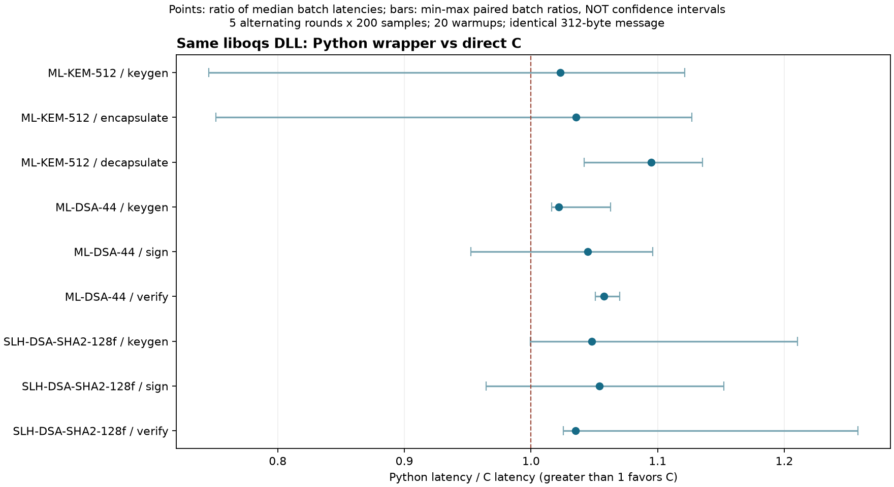

# Python wrapper or direct C?

The comparison uses one liboqs DLL and the same 312-byte message. Each of five rounds contains 200 samples per operation and language, after twenty warmups. Python and C alternate order and run in fresh processes.

Points show the ratio of median batch latencies. Bars show the minimum and maximum paired batch ratios, not confidence intervals. Values above one favor C.

The median of batch medians puts C about 2–9% ahead in this run:

| Operation | Python | C | Time saved |
|---|---:|---:|---:|
| ML-KEM-512 decapsulate | 26.00 µs | 23.75 µs | 8.7% |
| ML-DSA-44 verify | 66.30 µs | 62.70 µs | 5.4% |
| SLH-DSA sign | 19.68 ms | 18.68 ms | 5.1% |

Some batches favor Python. CPU frequency and background load were not controlled, and no statistical significance test was run.

Both versions execute C cryptographic code. The comparison measures wrapper, FFI, allocation, copying, and harness differences. C reuses buffers; the Python wrapper creates Python/ctypes buffers.

These results do not give me a reason to rewrite the whole project in C. Short operations such as decapsulation and verification show more consistent savings, but only a few microseconds per call. An end-to-end measurement would be the next check.

All nine operations are in [REPORT.md](REPORT.md), with raw samples in [results.json](results.json). This matched workload replaces comparisons against the older 16-byte native CSVs.
